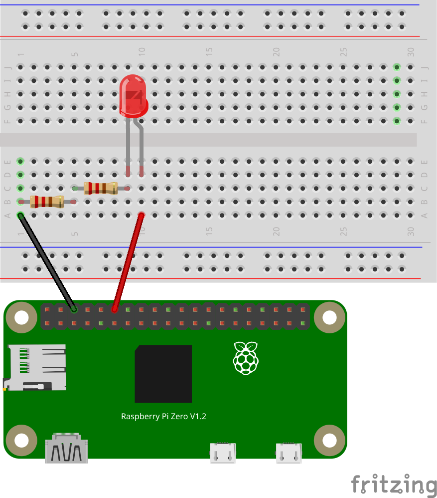

## rpi-dashcam
  - Turn a Raspberry Pi into a dashcam
  - Development has been paused until further notice due to hardware availability

## Features:
### Current features:
  - Storage rotation
  - External storage support
  - Recording activity light
  - Automatic video segmentation
  - Automatic start on boot
  - Timestamp (RTC) based filenames, with conflict resolution

### Planned features:
  - Frame rate and encoding configs
  - UPS driver script system
  - Dockerisation
    - Started on `experimental-docker`
    - This is untested and not expected to work, but also needs a 64-bit Raspberry Pi

## Dependencies:
  - `bash`
  - `python3`
  - `python3-picamera2`
  - `gpiozero`

## Installation:
### Hardware:
  - Attach a camera supported by `python3-picamera2`
  - Attach a UPS, configured to restart the Raspberry Pi when power is connected
    - Configure the Raspberry Pi to shut down if the UPS loses power for more than 10 seconds
    - This will let the dashcam start with the ignition and shut down when the car turns off
  - Set up the activity light according to the diagram:

  - Optionally, attach and configure an RTC for offline timekeeping
    - Without it, files will have incorrect timestamps
  - Optionally, format and attach external storage
    - The config file will need adjusting, see [Config](#config)

### Software:
  - Run `./setup-service.sh` to enable automatic start
  - Reboot
    - Alternatively, use `systemctl start rpi-dashcam.service` to start without rebooting
  - It's recommended to slim down the operating system to the bare minimum, see [Optimisation](#optimisation)

## Config:
  - Configs are created when missing
  - On launch, existing configs are patched to add new settings and remove old ones

### General:
  - General config is found in `general-config.json`
  - `fixedRecordingPath ("~/Videos")`: Path to save recordings to
  - `storagePartUUID ("")`: = UUID of a partition to use for storage
  - `useDedicatedPart (False)`: = Toggle between a fixed path or partition
  - `rotationThresholdBytes (16 * 1024 * 1024 * 1024)`: Clear storage when free space drops below this threshold
  - `activityLightPin (18)`: = GPIO pin to use for the activity light

### Recording:
  - General config is found in `recording-config.json`, with a patch configured by `general-config.json`
  - `bitRate (1000000 * 8) `: TODO
  - `width (1920)`: TODO
  - `height (1080)`: TODO
  - `duration (3600)`: Length of each recording before being split, in seconds = 3600 #In seconds

## Optimisation:
  - Disable WiFi and Bluetooth
  - Disable the splash screen and boot delay
  - Remove unused packages with boot hooks, such as `rpi-eeprom` and `cloud-init`
  - Disable unused units, such as `avahi-daemon` and `sound.target`
    - Any unused networking targets can also be disabled
  - Use a read-only root filesystem and disable `fsck`

## Licence:
  - All code is licensed under the MIT licence
  - `docs/diagram-0.png` is licensed under CC-By-SA 3.0
